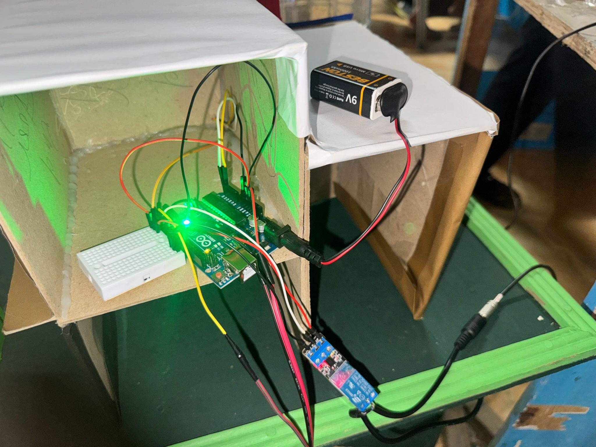

# Project AquaFlush 🌊

**Arduino-Based Water-Flow Monitoring Prototype for Small Urban Drainage Systems**

*Academic group project · BCA144 · MSU-Iligan Institute of Technology · May 2025*

AquaFlush is a laboratory-scale drainage model developed in response to flooding concerns near MSU-IIT in Barangay Tibanga, Iligan City. The prototype demonstrates **water-flow measurement and local display** using an Arduino Uno, water-flow sensor, and 16×2 I²C LCD.

> **Scope clarification:** The 2025 presentation proposed smart clogging detection, automatic pump response, and an IoT/data pipeline. The **only firmware the team used**, as confirmed by a project member, was the short flow-monitoring sketch documented here. That sketch **does not implement automatic pump control, a clogging classification algorithm, or internet connectivity**.

## Project at a glance

| | |
|---|---|
| **Problem addressed** | Drainage obstruction and flooding in a local urban setting |
| **Implemented firmware** | Interrupt-based flow pulse counting, estimated flow rate (L/hour), LCD output, Serial output |
| **Hardware shown in presentation** | Arduino Uno, water-flow sensor, 16×2 I²C LCD, relay, water pump, miniature drainage model |
| **Implementation status** | Physical demonstration prototype; automated detection/IoT pipeline are proposed features, not validated software functions |
| **Year** | 2025 |
| **Platform** | Arduino Uno / ATmega328P |

## Prototype and operation

The flow sensor generates pulses as water moves through it. The Arduino reads those pulses using an external interrupt, counts them over approximately one second, and calculates an estimated flow reading. It displays the result on the I²C LCD and reports it through Serial Monitor (9600 baud).

```text
Water flow → Flow sensor (pulse output) → Arduino Uno
                                          ├── 16×2 I²C LCD (flow reading)
                                          └── Serial Monitor (9600 baud)
```

A miniature roadside drainage model and pump/relay hardware were part of the physical exhibit. Their presence in the hardware photographs should **not** be interpreted as evidence of firmware-controlled actuation.

## Hardware

- Arduino Uno (ATmega328P)
- Water-flow sensor (exact model should be verified)
- 16×2 I²C LCD (code assumes address `0x27`)
- Jumper wires and prototype wiring
- Miniature drainage demonstration model
- Water pump and 5 V relay included in the project presentation (not operated by the recovered firmware)

See [hardware notes](docs/HARDWARE.md).

## Firmware

**File:** [`AquaFlush_Original_Recovered.ino`](AquaFlush_Original_Recovered.ino)

The original source file was no longer available, so this file was **recovered/reconstructed from a screenshot of the 2025 presentation**. It reflects the original flow-monitoring approach and is not represented as a byte-for-byte authenticated archival file. It uses `Wire.h` and `LiquidCrystal_I2C.h`.

To review in Arduino IDE:
1. Install a compatible **LiquidCrystal I2C** library.
2. Select **Arduino Uno**.
3. Open the `.ino` sketch.
4. Verify/compile; for actual hardware, confirm the LCD I²C address and sensor calibration.
5. If testing, open Serial Monitor at **9600 baud**.

**Flow calculation:** The recovered sketch estimates L/hour from pulse frequency using a divisor of `7.5`. That constant is sensor-dependent; measurements are illustrative unless calibrated.

## Team and contributions

**Project team:** Phoebien D. Cañete, Dja-ver Q. Hassan, Tristan E. Listanco, Mary Grace V. Soronio, and Shanice Reih H. Tanque (as listed on the project presentation).

**Phoebien D. Cañete — Developed the Arduino code, connected the electronic components, and helped build the working prototype.**

**Tristan E. Listanco — Arduino programming, circuit wiring, and prototype construction.**

**Mary Grace V. Soronio — Arduino programming, circuit wiring, and prototype construction.**

**Shanice Reih H. Tanque — Arduino programming, circuit wiring, and prototype construction.**

**Dja-ver Q. Hassan — Arduino programming, circuit wiring, and prototype construction.**

This is a group academic project; individual contribution details beyond the above have not been independently documented.

## Limitations and future development

- The sketch monitors **flow**, but does not reliably determine whether a drainage pipe is clogged.
- No motor/relay actuation logic is present in the original code.
- No online telemetry or LGU dashboard was implemented in the documented firmware.
- The flow conversion factor, operating conditions, and real-world accuracy need calibration and controlled testing.
- Future work could introduce better hydraulic design, additional sensing, and a validated detection algorithm before considering autonomous responses.

## Prototype gallery

These are original photographs from the team's May 2025 demonstration presentation.


*Miniature street and drainage model.*

| Electronics and wiring | Water container and pump exhibit |
|---|---|
|  |  |

| LCD mounted in model | LCD close-up |
|---|---|
|  |  |

> **Evidence note:** The close-up LCD photo shows a pump-status label; the recovered flow-monitoring sketch does not contain pump-control or pump-status-display logic. Photos document the demonstration setup, not proof of undocumented firmware capabilities.

See the [photo catalog](docs/PHOTO_GALLERY.md).

## Laboratory report

📄 **[View the laboratory report (PDF)](AquaFlash%20Lab%20Report.pdf)** · [Browse the Arduino source](AquaFlush_Original_Recovered.ino) · [See the prototype gallery](#prototype-gallery)

The laboratory report covers the physical prototype and documented flow-monitoring functions. The report documents the monitoring prototype and distinguishes implemented work from proposed automation.

## Documentation

- [Hardware/wiring notes](docs/HARDWARE.md)
- [Prototype photo catalog](docs/PHOTO_GALLERY.md)
- [Implementation vs. proposed features](docs/PROJECT_SCOPE.md)
- Original presentation: *BCA144 AquaFlush*, May 2025. Available as the source document; not yet uploaded to this repository.
- Five original prototype photographs are embedded in the [gallery](#prototype-gallery) above.

## Safety

Any real pump must use a properly rated external supply and switching/protection circuitry. Do not drive a pump directly from an Arduino GPIO, and keep electronics protected from water.

---

**Portfolio summary:** Developed an Arduino-based water-flow monitoring prototype, integrating interrupt-based sensor acquisition, I²C display output, wiring, and a miniature drainage demonstration model.
